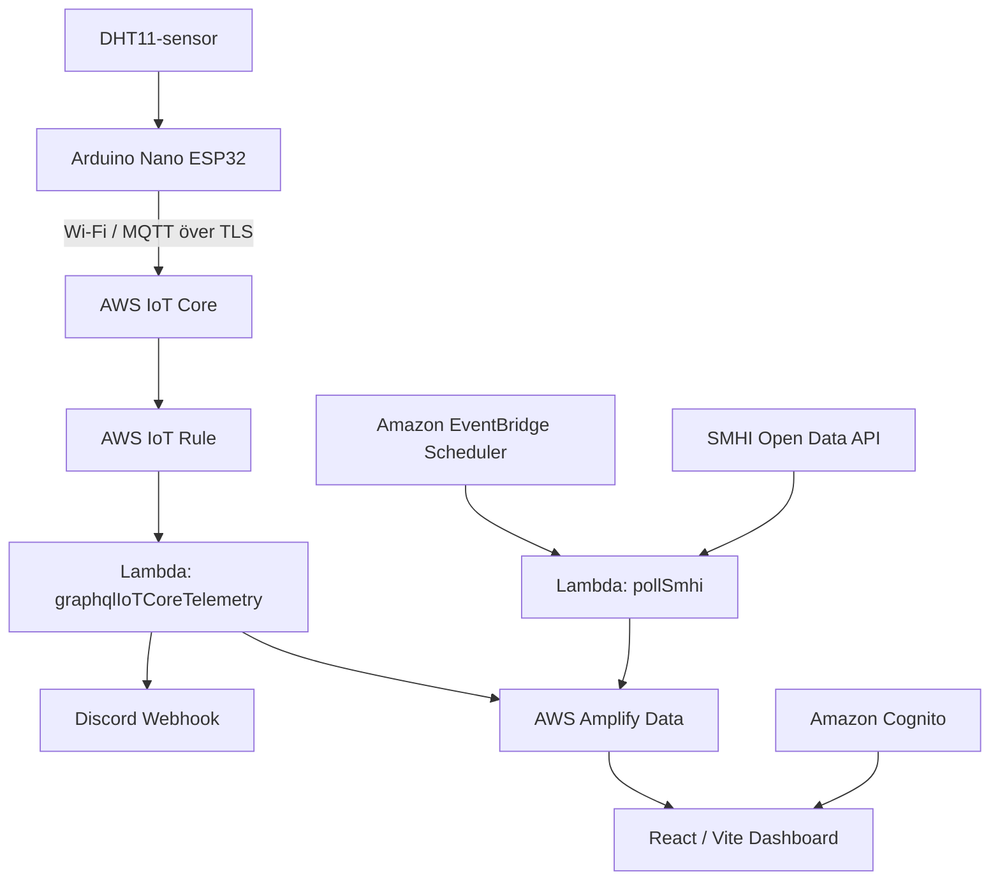

# 🌡️ IoT – Väder- och miljöövervakningssystem

### Smart miljöövervakning med ESP32, AWS Cloud, SMHI och Discord

Ett IoT-projekt som kopplar samman fysiska sensorer med molntjänster och omvandlar insamlad miljödata till användbar information genom en webbaserad dashboard.

**ESP32 · MQTT · AWS IoT Core · Lambda · Amplify · SMHI · Discord**

---

## 📌 1. Om projektet

Detta projekt visar hur en IoT-lösning kan hjälpa fastighetsägare att övervaka inomhusmiljön på distans.

Systemet samlar in temperatur- och luftfuktighetsvärden med hjälp av en DHT11-sensor som är ansluten till en Arduino Nano ESP32.

Mätvärdena skickas trådlöst via Wi-Fi med kommunikationsprotokollet MQTT till AWS IoT Core. Därefter behandlas informationen av AWS Lambda och lagras i AWS Amplify Data.

Projektet integrerar även väderobservationer från SMHI:s öppna API. Informationen presenteras i en webbaserad dashboard där användaren kan se och jämföra insamlade mätvärden.

Systemet har dessutom en Discord-integration som kan skicka meddelanden via en webhook.

### Projektets viktigaste funktioner

- 🌡️ Mätning av temperatur och luftfuktighet.
- 📡 Trådlös kommunikation via Wi-Fi och MQTT.
- ☁️ Databehandling med AWS molntjänster.
- 🗄️ Lagring av mätdata i AWS Amplify Data.
- 🌍 Hämtning av externa väderdata från SMHI.
- 📊 Webbaserad dashboard byggd med React och Vite.
- 💬 Meddelanden via Discord Webhooks.
- 🔐 Användarautentisering och behörighetskontroll med Amazon Cognito och Amplify.

---

## 🎯 2. Verksamhetsbehov och problemformulering

Fastighetsägare behöver ett enkelt sätt att övervaka inomhusmiljön i sina byggnader.

Temperatur och luftfuktighet påverkar bland annat komforten och inomhusmiljön. Utan ett automatiserat övervakningssystem kan det vara svårt att upptäcka förändringar utan att fysiskt kontrollera varje rum.

Projektet erbjuder en lösning där miljömätningar samlas in automatiskt, lagras i molnet och visas genom en webbaserad applikation.

**Projektets huvudsakliga mål är att:**

- Övervaka temperatur och luftfuktighet på distans.
- Lagra mätvärden för historisk analys.
- Jämföra sensordata med externa väderobservationer.
- Visa insamlade data i en användarvänlig dashboard.
- Möjliggöra notifieringar via Discord.

---

## 🏗️ 3. Systemarkitektur

Lösningen består av en fysisk sensor, trådlös kommunikation, AWS-molntjänster, extern API-integration och en webbaserad dashboard.

### Arkitekturdiagram



### Så fungerar dataflödet

1. DHT11-sensorn mäter temperatur och luftfuktighet.
2. Arduino Nano ESP32 läser av sensorns värden.
3. ESP32 skickar mätvärdena via Wi-Fi med MQTT.
4. AWS IoT Core tar emot meddelandena.
5. En AWS IoT Rule vidarebefordrar informationen till en Lambda-funktion.
6. Lambda behandlar informationen och sparar den i Amplify Data.
7. React-dashboarden hämtar och visar de lagrade mätvärdena.
8. En separat Lambda-funktion hämtar väderobservationer från SMHI.
9. Discord kan ta emot systemmeddelanden genom en konfigurerad webhook.

---

## 🔌 4. Hårdvara och kommunikation

### Hårdvarukomponenter

| Komponent | Funktion |
|---|---|
| Arduino Nano ESP32 | Mikrokontroller och huvudenhet |
| DHT11 | Sensor för temperatur och luftfuktighet |
| Wi-Fi | Trådlös internetanslutning |
| USB | Programmering och strömförsörjning |

### Kommunikation mellan sensor och moln

DHT11-sensorn är ansluten till Arduino Nano ESP32. ESP32 läser av mätvärdena och skickar informationen till AWS IoT Core med hjälp av MQTT.

**MQTT Topic:**

```text
esp32-hassan/telemetry
```

**Exempel på MQTT-meddelande:**

```json
{
  "temperature": 22.1,
  "humidity": 30
}
```

MQTT är ett lättviktigt kommunikationsprotokoll som ofta används inom IoT.

Protokollet bygger på en publish/subscribe-modell. Det innebär att enheter kan publicera meddelanden till ett ämne utan att behöva kommunicera direkt med den applikation som tar emot informationen.

---

## ☁️ 5. AWS – Molninfrastruktur

Projektet använder flera AWS-tjänster för att ta emot, behandla, lagra och presentera IoT-data.

| AWS-tjänst | Användningsområde |
|---|---|
| AWS IoT Core | Tar emot MQTT-meddelanden från ESP32 |
| AWS IoT Rules | Vidarebefordrar inkommande sensordata |
| AWS Lambda | Behandlar sensordata och väderinformation |
| AWS Amplify Data | Lagrar och tillhandahåller applikationsdata |
| Amazon Cognito | Hanterar användarautentisering |
| Amazon EventBridge Scheduler | Schemalägger insamling av SMHI-data |
| Amazon DynamoDB | Har testats som ett alternativt lagringssystem |

### AWS Lambda-funktioner

Projektet använder flera Lambda-funktioner för olika uppgifter:

- `graphqlIoTCoreTelemetry` – behandlar ESP32-mätningar och stöder Discord-meddelanden.
- `graphqlIoTCoreStatus` – hanterar statusuppdateringar från enheter.
- `pollSmhi` – hämtar väderobservationer från SMHI och sparar dem i Amplify Data.

Serverless-arkitekturen minskar behovet av att själv administrera och underhålla servrar.

---

## 🌍 6. Integration med SMHI:s API

Systemet använder **SMHI Open Data API** för att hämta externa väderobservationer.

En AWS Lambda-funktion (`pollSmhi`) körs automatiskt via Amazon EventBridge Scheduler. Funktionen hämtar temperaturmätningar från SMHI:s väderstation med stations-ID `72420`.

Därefter skickas väderinformationen till Amplify Data, där den lagras tillsammans med sensordata från ESP32.

På så sätt kan användaren jämföra inomhustemperaturen med utomhustemperaturen i samma dashboard.

---

## 🗄️ 7. Databas och lagring

Systemet använder AWS Amplify Data för att lagra och hantera mätvärden.

Följande information samlas in:

- Temperatur från DHT11-sensorn.
- Luftfuktighet från DHT11-sensorn.
- Temperatur från SMHI:s API.
- Enhetsinformation och tidsstämplar.

Data lagras strukturerat så att den kan hämtas och presenteras i dashboarden.

DynamoDB har även testats separat som en alternativ lagringslösning.

### Skillnaden mellan lagring och visualisering

- **AWS Amplify Data:** ansvarar för lagring och tillhandahållande av data.
- **React och Vite:** används för att bygga användargränssnittet.
- **Dashboarden:** hämtar data och presenterar den för användaren.

Databasen hanterar alltså lagringen, medan dashboarden ansvarar för visualiseringen.

---

## 📊 8. Visualisering och användargränssnitt

Systemet har ett webbgränssnitt utvecklat med React och Vite och kopplat till AWS Amplify.

Dashboarden gör det möjligt att:

- Se aktuell temperatur och luftfuktighet från ESP32.
- Se temperaturdata från SMHI.
- Jämföra inomhus- och utomhustemperatur.
- Följa insamlade mätvärden.
- Se registrerade IoT-enheter.

Användaren loggar in med Amazon Cognito innan skyddade data visas.

---

## 💬 9. Notifieringar via Discord

Systemet kan skicka notifieringar till Discord med hjälp av en webhook.

När funktionen är aktiverad kan systemet skicka information om inkommande sensordata och enhetsstatus till en Discord-kanal.

Detta ger användaren ytterligare ett sätt att följa systemet utan att hela tiden behöva öppna dashboarden.

Webhook-adressen lagras som konfiguration och ska inte publiceras i GitHub.

---

## 🔐 10. Säkerhet

Säkerhet har beaktats i både kommunikationen mellan enheterna och åtkomsten till molntjänsterna.

Viktiga säkerhetsåtgärder:

- ESP32 använder certifikat och TLS för anslutning till AWS IoT Core.
- MQTT-kommunikationen sker via en krypterad anslutning.
- Amazon Cognito används för användarinloggning.
- Åtkomst till Devices och Telemetry begränsas med ägarbaserad behörighet.
- Lambda-funktioner använder IAM-behörigheter för åtkomst till nödvändiga resurser.
- Hemligheter och privata nycklar exkluderas från GitHub med `.gitignore`.

Säkerheten kan förbättras ytterligare genom att begränsa IoT-policyer till specifika enheter och MQTT-topics samt genom att validera inkommande meddelanden.

---

## 📈 11. Skalbarhet och vidareutveckling

Arkitekturen är uppbyggd av separata komponenter, vilket gör det möjligt att vidareutveckla systemet.

Exempel på framtida förbättringar:

- Ansluta flera ESP32-enheter och sensorer.
- Övervaka fler fastigheter eller rum.
- Lägga till fler väderparametrar från SMHI.
- Skapa grafer för historiska mätvärden.
- Införa larm vid för hög eller låg temperatur eller luftfuktighet.
- Förbättra enhetshantering och övervakning.

AWS IoT Core, Lambda och Amplify gör det möjligt att bygga vidare utan att behöva ersätta hela arkitekturen.

### Skalbarhet i IoT-system

Genom att använda MQTT och AWS IoT Core kan flera enheter skicka data till samma molninfrastruktur.

Lambda-funktioner kan köras vid behov och Amplify Data kan användas för att hantera data från flera enheter.

Det gör arkitekturen lämplig för framtida utbyggnad med fler sensorer och mätpunkter.

---

## 🧪 12. Testning

Följande delar har testats under projektets utveckling:

- ESP32 ansluter till Wi-Fi och AWS IoT Core.
- DHT11 läser av temperatur och luftfuktighet.
- Sensordata publiceras via MQTT.
- AWS IoT Rule skickar data vidare till Lambda.
- Lambda-funktionen sparar sensordata i Amplify Data.
- Dashboarden visar inkommande sensordata.
- SMHI-integrationen hämtar och visar temperaturdata.
- Discord-integrationen har testats och skickat notifieringar.

---

## 💻 13. GitHub och dokumentation

Projektets källkod och dokumentation finns i GitHub.

Repository innehåller bland annat ESP32-programmet, AWS Amplify-koden och projektets dokumentation.

ESP32-programmet finns i mappen `esp32/`.

Hemligheter, privata nycklar och certifikat som inte ska delas är exkluderade från versionshanteringen med hjälp av `.gitignore`.

---

## 🏁 14. Slutsats

Projektet visar hur en IoT-lösning kan byggas med en fysisk sensor, trådlös kommunikation och molnbaserade tjänster.

Genom att kombinera ESP32, AWS IoT Core, Lambda, Amplify Data och SMHI:s API kan systemet samla in, lagra och visualisera miljödata.

Lösningen visar hur IoT kan användas för att möta ett verkligt verksamhetsbehov och har en arkitektur som kan vidareutvecklas för fler sensorer, enheter och användningsområden.
