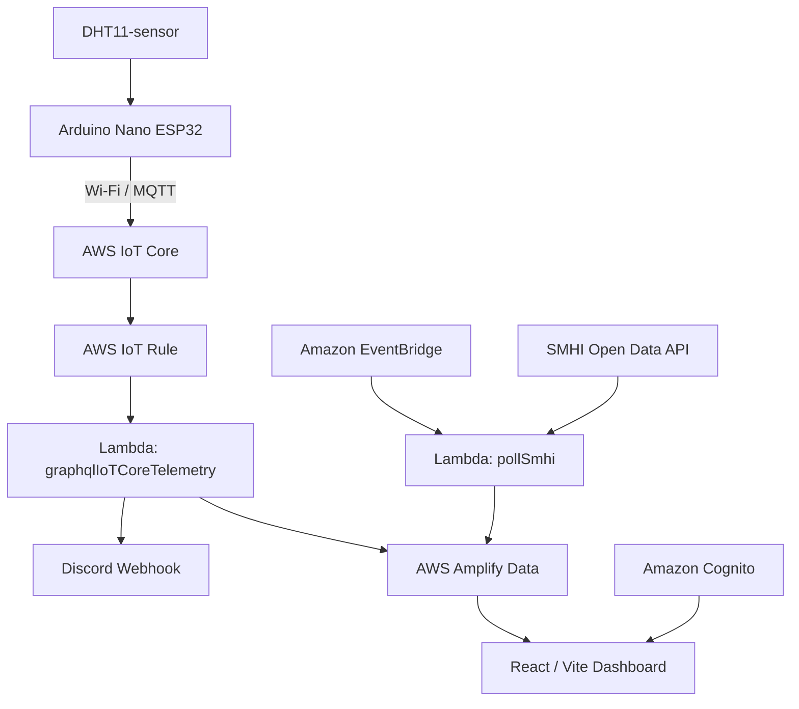

# 🌡️ IoT – Väder- och miljöövervakningssystem

### Smart miljöövervakning med ESP32, AWS Cloud, SMHI och Discord

Ett komplett IoT-projekt som kopplar samman fysiska sensorer med molntjänster och omvandlar insamlad miljödata till användbar information genom en webbaserad dashboard.

**ESP32 · MQTT · AWS IoT Core · Lambda · Amplify · SMHI · Discord**

---

## 📌 1. Om projektet

Detta projekt har utvecklats för att visa hur en IoT-lösning kan hjälpa fastighetsägare att övervaka inomhusmiljön på distans.

Systemet samlar in temperatur- och luftfuktighetsvärden med hjälp av en DHT11-sensor som är ansluten till en Arduino Nano ESP32.

Mätvärdena skickas trådlöst via Wi-Fi med kommunikationsprotokollet MQTT till AWS IoT Core. Därefter behandlas informationen av AWS Lambda och lagras i AWS Amplify Data.

Projektet integrerar även väderobservationer från SMHI:s öppna API. Informationen presenteras i en webbaserad dashboard där användaren kan se insamlade mätvärden.

Systemet har dessutom en Discord-integration som kan skicka meddelanden via en webhook.

### ✨ Projektets viktigaste funktioner

- 🌡️ Mätning av temperatur och luftfuktighet.
- 📡 Trådlös kommunikation via Wi-Fi och MQTT.
- ☁️ Databehandling med AWS molntjänster.
- 🗄️ Lagring av mätdata i AWS Amplify Data.
- 🌍 Hämtning av externa väderdata från SMHI.
- 📊 Webbaserad dashboard byggd med React och Vite.
- 💬 Meddelanden via Discord Webhooks.
- 🔐 Användarautentisering och behörighetskontroll med Amazon Cognito och Amplify.

---

## 🎯 2. Verksamhetsbehov och problemformulering

Fastighetsägare behöver ett enkelt sätt att övervaka inomhusmiljön i sina byggnader.

Temperatur och luftfuktighet påverkar bland annat komforten och byggnadens inomhusmiljö. Utan ett automatiserat övervakningssystem kan det vara svårt att upptäcka förändringar utan att fysiskt kontrollera varje rum.

Projektet erbjuder en lösning där miljömätningar samlas in automatiskt, lagras i molnet och kan visas genom en webbaserad applikation.

**Projektets huvudsakliga mål är att:**

- Övervaka temperatur och luftfuktighet på distans.
- Lagra mätvärden för historisk analys.
- Jämföra sensordata med externa väderobservationer.
- Visa insamlade data i en användarvänlig dashboard.
- Möjliggöra kommunikation och meddelanden via Discord.

---

## 🏗️ 3. Systemarkitektur

Lösningen består av en fysisk sensor, trådlös kommunikation, AWS-molntjänster, extern API-integration och en webbaserad dashboard.

### Arkitekturdiagram



### Så fungerar dataflödet

1. DHT11-sensorn mäter temperatur och luftfuktighet.
2. Arduino Nano ESP32 läser av sensorns värden.
3. ESP32 skickar mätvärdena via Wi-Fi med MQTT.
4. AWS IoT Core tar emot meddelandena.
5. En AWS IoT Rule vidarebefordrar informationen till en Lambda-funktion.
6. Lambda behandlar informationen och sparar den i Amplify Data.
7. React-dashboarden hämtar och visar de lagrade mätvärdena.
8. En separat Lambda-funktion hämtar väderobservationer från SMHI.
9. Discord kan ta emot systemmeddelanden genom en konfigurerad webhook.

---

## 🔌 4. Hårdvara och kommunikation

### Hårdvarukomponenter

| Komponent | Funktion |
|---|---|
| Arduino Nano ESP32 | Mikrokontroller och huvudenhet |
| DHT11 | Sensor för temperatur och luftfuktighet |
| Wi-Fi | Trådlös internetanslutning |
| USB | Programmering och strömförsörjning |

### Kommunikation mellan sensor och gateway

DHT11-sensorn är ansluten till Arduino Nano ESP32.

ESP32 läser av mätvärdena och skickar informationen till AWS IoT Core med hjälp av MQTT.

**MQTT Topic:**

```text
esp32-hassan/telemetry
```

**Exempel på MQTT-meddelande:**

```json
{
  "temperature": 22.1,
  "humidity": 30
}
```

MQTT är ett lättviktigt kommunikationsprotokoll som ofta används inom IoT.

Protokollet bygger på en publish/subscribe-modell. Det innebär att enheter kan publicera meddelanden till ett ämne utan att behöva kommunicera direkt med den applikation som tar emot informationen.

---

## ☁️ 5. AWS – Molninfrastruktur

Projektet använder flera AWS-tjänster för att ta emot, behandla, lagra och presentera IoT-data.

| AWS-tjänst | Användningsområde |
|---|---|
| AWS IoT Core | Tar emot MQTT-meddelanden från ESP32 |
| AWS IoT Rules | Vidarebefordrar inkommande sensordata |
| AWS Lambda | Behandlar sensordata och väderinformation |
| AWS Amplify Data | Lagrar och tillhandahåller applikationsdata |
| Amazon Cognito | Hanterar användarautentisering |
| Amazon EventBridge | Schemalägger insamling av SMHI-data |
| Amazon DynamoDB | Har testats som ett alternativt lagringssystem |

### AWS Lambda-funktioner

Projektet använder flera Lambda-funktioner för olika uppgifter:

- `graphqlIoTCoreTelemetry` – behandlar ESP32-mätningar och stöder Discord-meddelanden.
- `graphqlIoTCoreStatus` – hanterar statusuppdateringar från enheter.
- `pollSmhi` – hämtar väderobservationer från SMHI och sparar dem i Amplify Data.

Serverless-arkitekturen minskar behovet av att själv administrera och underhålla servrar.

---

## 🌍 6. Integration med SMHI:s API

Systemet använder **SMHI Open Data API** för att hämta externa väderobservationer.

En Lambda-funktion hämtar temperaturmätningar från SMHI:s väderstation med stations-ID `72420`.

Informationen lagras sedan i Amplify Data och kan
