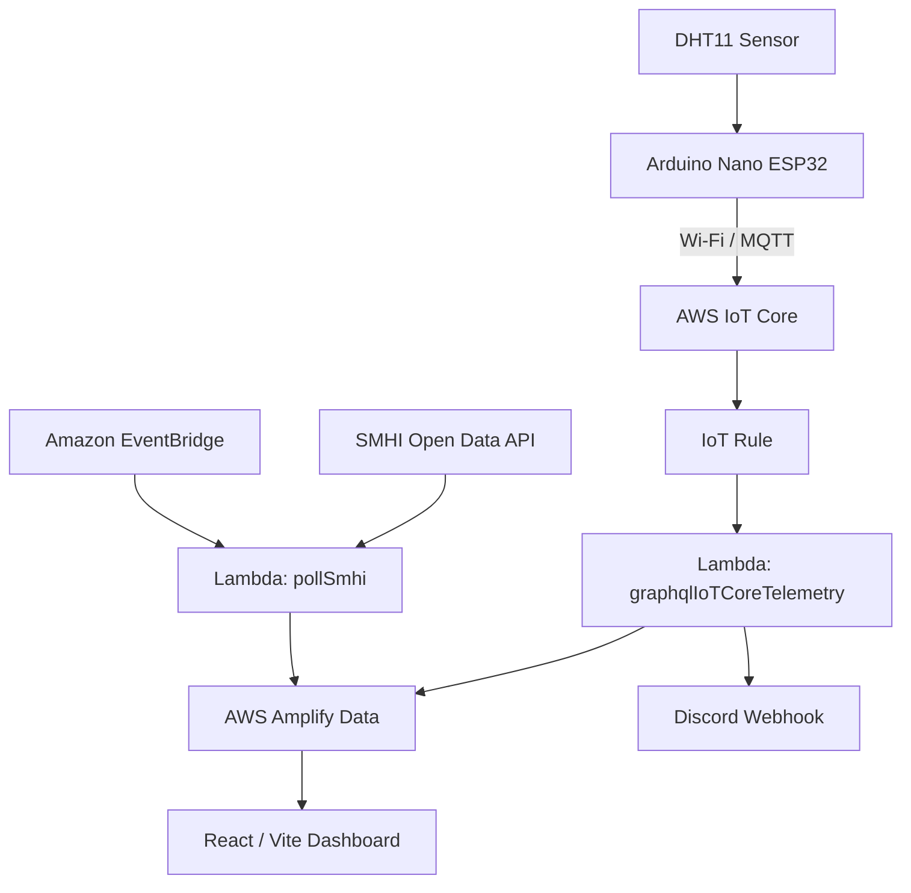

# IoT Weather & Environment Monitoring System

## 1. Project Overview

This project is an IoT-based monitoring system developed to help property owners monitor indoor environmental conditions and access local weather information.

The system collects temperature and humidity data from a DHT11 sensor connected to an Arduino Nano ESP32. Sensor data is transmitted over Wi-Fi using MQTT to AWS IoT Core, processed by AWS Lambda, and stored in AWS Amplify Data.

The application also retrieves weather observations from the SMHI Open Data API and displays the collected information in a web dashboard.

## 2. Business Need

Property owners need a simple way to monitor indoor environmental conditions. Temperature and humidity can affect comfort, building conditions, and the indoor environment.

This solution provides:
- Remote access to temperature and humidity readings.
- Historical sensor data in a web dashboard.
- External weather observations from SMHI.
- Discord notifications through webhook integration.

## 3. System Architecture



## 4. Hardware and Communication

**Hardware**
- Arduino Nano ESP32
- DHT11 temperature and humidity sensor
- Wi-Fi connection

**Communication**

The ESP32 reads temperature and humidity values from the DHT11 sensor and publishes the readings as JSON messages using MQTT.

MQTT topic:

`esp32-hassan/telemetry`

Example message:

```json
{
  "temperature": 22.1,
  "humidity": 30
}
```

AWS IoT Core receives the MQTT messages and forwards them through an IoT Rule.

## 5. AWS Cloud Services

The project uses the following AWS services:

- **AWS IoT Core:** Receives MQTT messages from the ESP32.
- **AWS IoT Rules:** Routes incoming sensor data to the processing function.
- **AWS Lambda:** Processes sensor data and SMHI weather observations.
- **AWS Amplify Data:** Provides the GraphQL data layer and stores device and telemetry records.
- **Amazon Cognito:** Handles user authentication.
- **Amazon EventBridge:** Triggers scheduled SMHI data collection.

## 6. External API Integration – SMHI

The project integrates with the SMHI Open Data API.

A Lambda function retrieves weather observations from SMHI for weather station `72420` and stores the temperature readings in Amplify Data.

This allows the dashboard to display both locally collected sensor data and external weather information.

## 7. Discord Integration

Discord webhook integration allows the system to send messages to a Discord channel.

The Lambda functions can send telemetry and device-status messages using the configured webhook.

This provides another way to receive information from the IoT system without constantly checking the dashboard.

## 8. Data Storage and Visualization

The project separates data storage from data visualization.

**Data storage:**
AWS Amplify Data stores device information and telemetry records. The data includes device identifiers, timestamps, temperature, humidity when available, and owner information.

**Data visualization:**
A React and Vite web application displays the stored data in a dashboard. Users authenticate through Amazon Cognito.

The dashboard is the presentation layer, while Amplify Data is the data layer.

A separate experimental Lambda function has also been tested with Amazon DynamoDB to demonstrate an alternative storage approach.

## 9. Security

Security is an important part of the system.

Implemented security measures include:
- User authentication through Amazon Cognito.
- Owner-based authorization for device and telemetry data.
- IAM permissions for Lambda functions accessing Amplify Data.
- MQTT communication through AWS IoT Core.
- HTTPS connections to external services.
- Public API-key access rules removed from the Devices and Telemetry models.

Webhook URLs should be treated as secrets and must not be published in the repository.

## 10. Scalability

The architecture uses managed and serverless AWS services.

The solution can be expanded by:
- Registering additional ESP32 devices with unique device IDs.
- Receiving data from multiple devices through AWS IoT Core.
- Processing incoming messages with Lambda functions.
- Storing readings centrally in Amplify Data.
- Extending the dashboard to display several devices.

For a larger deployment, the system could be improved with message buffering, monitoring, error handling, data-retention policies, and optimized database queries.

## 11. Future Improvements

Possible future improvements include:
- Adding more environmental sensors.
- Creating configurable temperature and humidity thresholds.
- Sending alerts when measurements exceed configured limits.
- Applying machine learning to identify unusual environmental patterns.
- Adding more detailed historical charts and reports.

## 12. Conclusion

This project demonstrates an end-to-end IoT solution, from physical sensor communication to cloud processing, data storage, external API integration, and web-based visualization.

It combines ESP32, MQTT, AWS IoT Core, AWS Lambda, Amplify Data, Cognito, SMHI, and Discord in one connected system.
